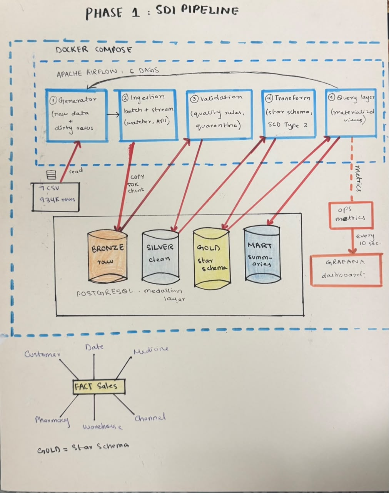

# Pharma Cold-Chain DWH — Phase 1: Sales & Demand Intelligence (SDI) Mart

An automated data-engineering pipeline, orchestrated by **Apache Airflow**, that builds the
**Sales & Demand Intelligence data mart** for a pharmaceutical cold supply chain. Phase 1 runs
up to the **analytical query layer**:

**data generation → file-watcher / API ingestion (batch + stream) → bronze → validated silver
(ODS) → gold star schema → optimized query layer**, observed live on four Grafana dashboards.

| Deliverable (Phase 1) | Where |
|---|---|
| Project report (max 5 pages) | [`docs/Phase.1.Report.pdf`](docs/Phase.1.Report.pdf) (editable: `.docx`) |
| SDI Excel workbook | [`docs/SDI.Excel.xlsx`](docs/SDI.Excel.xlsx) |
| Oversampling report (1–2 pages) | [`docs/Oversampling.Report.pdf`](docs/Oversampling.Report.pdf) |
| Demo video (2 min) | **[▶ Watch on YouTube](https://youtu.be/4zfcwfCU-Rk)** · script: [`docs/VIDEO_SCRIPT.md`](docs/VIDEO_SCRIPT.md) |
| All code | `dags/`, `src/`, `sql/`, `grafana/`, `docker-compose.yml` |
| Group members | [`MEMBERS.md`](MEMBERS.md) |



## Architecture at a glance

| Layer (spec) | Implementation | Metrics → dashboard |
|---|---|---|
| Data oversampling | `sdi_00_data_generator` — seasonal bootstrap (same month last year, +12 months, +8 % YoY), consistent re-keying for lineage, injected dirty data | generator manifest |
| Data ingestion — batch | `file-watcher` (watchdog) → Airflow REST API → `sdi_01_batch_ingestion` (one mapped task per file, SHA-256 de-dup, atomic claim, COPY) | `ops.batch_load_log` → **1 · Batch Ingestion** |
| Data ingestion — stream | `sdi_02_stream_ingestion` → FastAPI `POST /ingest/stream/sales` in micro-batches | `ops.stream_metrics` → **2 · Streaming** |
| Storage & staging | PostgreSQL medallion: `raw` (bronze) → `staging` (silver/ODS) + `quarantine`; `sdi_03_silver_validation` with 37 DQ rules and a quality gate | `ops.storage_snapshot`, `ops.dq_results` → **3 · Storage & Staging** |
| Transformation & dimensional modeling | `sdi_04_gold_transform` — SCD2 Medicine & Organization, junk + role-playing dims, 3 facts, incremental by watermark | `ops.transform_log` |
| Analytical query layer & optimization | `sdi_05_query_layer` — 13 dimensional queries, 6 materialized views, year partitions, BRIN/B-tree indexes, benchmark baseline vs optimized | `ops.query_log`, `pg_stat_statements` → **4 · Query Layer** |

The layers are chained with **Airflow Datasets** (`BRONZE → SILVER → GOLD`), so each layer runs
automatically as soon as the layer below publishes new data.

## Prerequisites

* **Docker Desktop** (Windows: enable the WSL 2 backend), with at least **6 GB RAM** allotted
* The 7 source CSV files from the course (not committed: they are ~330 MB)

## Run it

```bash
# 1. put the 7 CSVs here (exact names 01_master_data.csv … 07_iot_streaming_data.csv)
cp /path/to/Pharma.Supply.Chain.Dataset/*.csv data/source/

# 2. start everything (first build takes a few minutes)
docker compose up -d --build

# 3. open the UIs
#    Airflow  http://localhost:8080   admin / admin
#    Grafana  http://localhost:3000   admin / admin  (folder "Pharma DWH - Data Engineering")
#    API      http://localhost:8000/docs
```

Then, in Airflow, trigger **`sdi_00_data_generator`** three times, waiting for
`sdi_05_query_layer` to finish in between (each takes ~1–2 min):

| Run | Config | What happens |
|---|---|---|
| Initial load | `{"refresh_id": "R0"}` | the 2023–2025 history (934k rows) is ingested and modelled |
| **Refresh 1** | `{"refresh_id": "R1"}` | Jan-2026 is generated (~103k sales, January peak) + e-commerce stream |
| **Refresh 2** | `{"refresh_id": "R2"}` | Feb-2026 is generated + SCD2 changes (3 medicine versions, 1 pharmacy rebrand) |

Watch the Grafana dashboards update on each run (auto-refresh 10 s; use the *Refresh* filter
to compare R0/R1/R2).

**Without Airflow** (quick check / debugging), the same code runs as plain Python:

```bash
pip install -r requirements.txt
python -m src.pipeline init
python -m src.pipeline refresh R0
python -m src.pipeline refresh R1 --stream
python -m src.pipeline refresh R2 --stream
```

Reset everything: `docker compose down -v` (deletes the database volume), then empty
`data/landing`, `data/archive`, `data/stream`.

## Repository layout

```
dags/                    Airflow DAGs (orchestration only) + common.py (retries, SLA, Datasets)
src/
  generator/             oversampling layer
  ingestion/             batch loader, stream ingest, watchdog file-watcher, FastAPI API
  validation/            DQ rule catalogue (rules.py) + silver loader
  transform/             gold-layer step runner
  query/                 query catalogue (13 queries × baseline/optimized) + benchmark
  storage/               storage & date-coverage metrics
  pipeline.py            one function per task; CLI entry point
sql/
  ddl/                   schemas, ops metrics tables, bronze, silver, gold star schema, seeds
  load/                  SCD2 dimensions, conformed/junk dimensions, incremental fact loads
  optimize/              indexes, materialized views, concurrent refresh
grafana/                 provisioning + 4 dashboards as JSON (built by scripts/build_grafana_dashboards.py)
config/pipeline.yaml     every tunable: refresh calendar, growth, dirty-data rates, stream size, DQ gate
docker/                  Dockerfile (Airflow + deps), Postgres init (Airflow DB, read-only Grafana role)
scripts/                 build Excel workbook, report figures, dashboards, raw DDL
docs/                    report, Excel, oversampling report, diagrams, video script
tests/                   unit tests (no database needed)
```

## Results of the reference run (R0 → R1 → R2)

| | R0 history | R1 Jan-2026 | R2 Feb-2026 |
|---|---|---|---|
| Source rows (history / generated) | 934,448 | 116,822 | 22,022 |
| Rows quarantined | 0 | 1,249 (1.16 %) | 142 (1.07 %) |
| Gold sales fact rows (cumulative) | 500,000 | 601,728 | 610,039 |
| SCD2 new versions | – | 0 | 3 medicine + 1 organisation |
| End-to-end refresh time | 80 s | 72 s | 54 s |

Query layer: 13 queries, average 180 ms on the star schema vs 6.3 ms optimized (median 37×,
max 239×), identical results for every query.

## Regenerating the documents

```bash
DWH_DB_BACKEND=psql python scripts/build_grafana_dashboards.py
DWH_DB_BACKEND=psql python scripts/make_report_figures.py
DWH_DB_BACKEND=psql python scripts/build_sdi_excel.py docs/template_SDI_planning.xlsx docs/SDI.Excel.xlsx
node docs/report_src/build_reports.js     # then export the .docx files to PDF
```
(`DWH_DB_BACKEND=psql` uses the `psql` client instead of psycopg2; omit it where psycopg2 is installed.)
